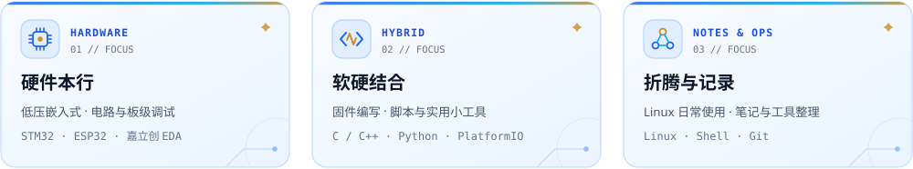
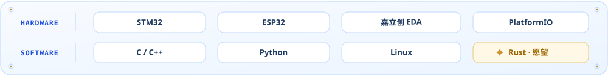

  <picture>
    <source media="(prefers-color-scheme: dark)" srcset="./assets/hero-header-dark.svg" />
    <source media="(prefers-color-scheme: light)" srcset="./assets/hero-header-light.svg" />
    
  </picture>

做**低压嵌入式硬件**的工程师，平时主要和电路、板子和芯片手册打交道，也喜欢顺手写点软件，把硬件调试和日常小工具串在一起。

比起堆砌概念，更喜欢做能跑得稳、用得顺手的东西；Rust 还在愿望清单里。欢迎四处看看，也欢迎来聊。

 

  <picture>
    <source media="(prefers-color-scheme: dark)" srcset="./assets/workbench-dark.svg" />
    <source media="(prefers-color-scheme: light)" srcset="./assets/workbench-light.svg" />
    
  </picture>

  <picture>
    <source media="(prefers-color-scheme: dark)" srcset="./assets/divider-dark.svg" />
    <source media="(prefers-color-scheme: light)" srcset="./assets/divider-light.svg" />
    
  </picture>

### 「常去的地方」

  <a href="https://reqing.online">
    <picture>
      <source media="(prefers-color-scheme: dark)" srcset="./assets/portal-reqing-dark.svg" />
      <source media="(prefers-color-scheme: light)" srcset="./assets/portal-reqing-light.svg" />
      
    </picture>
  </a>

### 「手边常用」

  <picture>
    <source media="(prefers-color-scheme: dark)" srcset="./assets/stack-board-dark.svg" />
    <source media="(prefers-color-scheme: light)" srcset="./assets/stack-board-light.svg" />
    
  </picture>

### 「最近留下的脚印」

  <a href="https://github.com/reqingonline">
    <picture>
      <source media="(prefers-color-scheme: dark)" srcset="https://github-readme-activity-graph.vercel.app/graph?username=reqingonline&amp;theme=github-compact&amp;hide_border=true&amp;area=true&amp;bg_color=0d1117&amp;color=58a6ff&amp;line=58a6ff&amp;point=c9d1d9" />
      <source media="(prefers-color-scheme: light)" srcset="https://github-readme-activity-graph.vercel.app/graph?username=reqingonline&amp;theme=github-light&amp;hide_border=true&amp;area=true" />
      
    </picture>
  </a>

### 「找到我」

  <a href="mailto:davidhengshaw@gmail.com">Email · davidhengshaw@gmail.com</a> &nbsp;·&nbsp;
  <a href="https://telegram.me/Xiaore923">Telegram · @Xiaore923</a> &nbsp;·&nbsp;
  <a href="./pgp-key.asc">OpenPGP · <code>7ABE 0801 596D 6C33</code></a>（<a href="https://keys.openpgp.org/vks/v1/by-fingerprint/7D11B30D7B3F03CA1AD62C407ABE0801596D6C33">keys.openpgp.org</a>）

  

  <picture>
    <source media="(prefers-color-scheme: dark)" srcset="./assets/footer-morning-pulse-dark.png" />
    <source media="(prefers-color-scheme: light)" srcset="./assets/footer-morning-pulse.png" />
    
  </picture>

